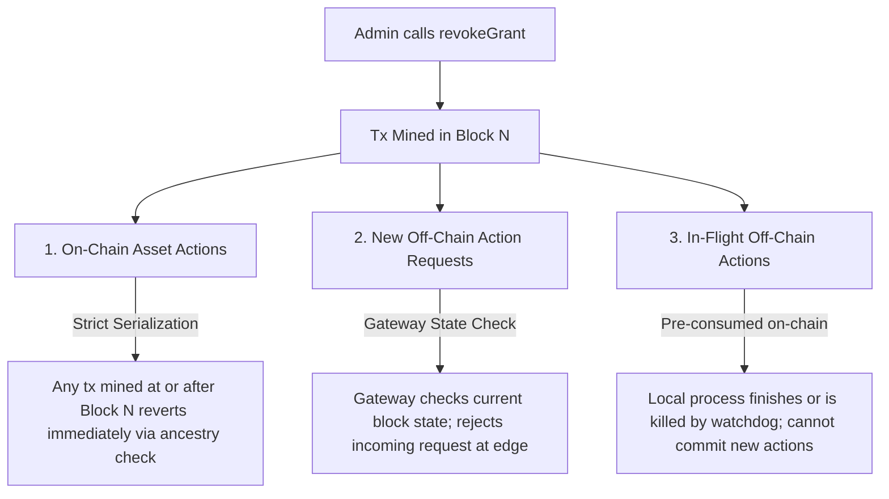

# Aegis: Architecture Document

## 1. System Overview & Objectives

**Aegis** is an authenticated delegation and authorization protocol for autonomous AI agents acting on behalf of human principals or organizations. It establishes a verifiable, bounded, revocable, and auditable security perimeter around agent interactions.

### 1.1 Core Principle
> **The AI proposes actions; Aegis governs which actions are authorized.**  
> Under no circumstances is the language model's internal reasoning, prompt constraint adherence, or self-reported compliance treated as a trusted security boundary.

### 1.2 Theoretical Foundation: Connection to South et al. (ICML 2025)
In *"Position: AI Agents Need Authenticated Delegation"* (ICML 2025), Tobin South et al. argue that deploying autonomous agents requires:
1. **Authentication of Identity:** Distinguishing AI agents from human principals while linking each agent to a verifiable delegator.
2. **Deterministic Scoping:** Moving away from brittle natural language constraints to unambiguous, machine-readable structured permissions.
3. **Chains of Accountability:** Preserving verifiable delegation lineages across multi-agent handoffs.
4. **Auditability:** Providing non-repudiable proof of permissions, decisions, and execution receipts.

Aegis implements these foundational principles by combining a decentralized EVM state machine with a hardened off-chain **Execution Gateway**.

---

## 2. System Architecture & Component Decomposition

```mermaid
graph TD
    subgraph Human / Operator Domain
        User([Human Delegator / Owner])
        UI[Aegis Dashboard (React + Vite)]
    end

    subgraph Agent Domain
        AgentA[Parent Agent A]
        AgentB[Child Agent B]
    end

    subgraph Off-Chain Enforcement Boundary (TCB)
        Gateway[Aegis Execution Gateway (Fastify/TypeScript)]
        SchemaVal[Schema & Input Validator (Zod)]
        SigVerify[EIP-712 Signature & Nonce Verifier]
        AuditDB[(SQLite Audit Store)]
        ToolRunner[Sandboxed Tool Adapters]
    end

    subgraph On-Chain Policy & Settlement Layer (EVM)
        PolicyMgr[AegisPolicyManager.sol<br/>Canonical Policy & Budget Ledger]
        Vault[AgentVault.sol<br/>Test Asset Custody]
        MockToken[MockUSDC.sol<br/>ERC-20 Token]
    end

    subgraph Target Environment (Sandbox)
        GitRepo[Local Git Repository Sandbox]
        TempFS[Local Filesystem Sandbox]
    end

    User -->|Creates Root Grant / Revokes| UI
    UI -->|Admin Tx| PolicyMgr
    User -->|Delegates authority| AgentA
    AgentA -->|Delegates subset of authority| AgentB

    AgentB -->|Signs EIP-712 ActionRequest| Gateway
    Gateway --> SchemaVal
    SchemaVal --> SigVerify
    SigVerify -->|Query Grant, Nonce, Budget & Revocation| PolicyMgr
    Gateway -->|Pre-consume Budget & Commit Receipt Hash| PolicyMgr
    Gateway -->|Execute Allowlisted Tool| ToolRunner
    ToolRunner --> GitRepo
    ToolRunner --> TempFS
    Gateway -->|Append Decision & Receipt| AuditDB

    AgentA -->|Signs EIP-712 VaultTransferRequest| Gateway
    Gateway -->|Relay Signed Tx or Direct Call| Vault
    Vault -->|Verify Policy & Quota| PolicyMgr
    Vault -->|Transfer Mock Tokens| MockToken

    UI -->|Read Grants & Events| PolicyMgr
    UI -->|Read Audit Trails| Gateway
```

---

## 3. Detailed Component Descriptions

### 3.1 Layer 1: On-Chain Policy & Settlement Layer (EVM)
The on-chain layer provides a single source of truth for grant hierarchies, cryptographic agent identity bindings, budget reservations, and asset custody.

- **`AegisPolicyManager.sol`**:
  - **Grant Storage:** Stores immutable roots and attenuated child grants.
  - **Hierarchy Tracking:** Maintains explicit `parentGrantId` pointers forming directed delegation trees.
  - **Scope & Expiry Validation:** Enforces bitmask tool restrictions and timestamp validity.
  - **EIP-712 Domain Separator:** Verifies structured signatures bound to `chainId` and `address(this)`.
  - **Budget Accounting Engine:** Maintains `maxTotalBudget`, `spent`, and `reservedChildBudget` per grant with zero-sum conservation.
  - **Ancestry Verification Engine:** Validates that an executing grant and every ancestor up to the root is unrevoked and unexpired.
  - **Expired Budget Reclamation:** Enables permissionless reclamation of unspent child allocations post-expiration.
  - **Receipt Hash Anchor:** Emits `ReceiptCommitted` events carrying cryptographic hashes of off-chain execution outcomes.
- **`AgentVault.sol`**:
  - Custodies protocol-controlled test assets (e.g., `MockUSDC`).
  - Directly enforces permission checks before transferring tokens: checks EIP-712 agent signature, active grant, tool bit `0x10`, per-action cap, and unspent subtree budget in `AegisPolicyManager`.
- **`MockUSDC.sol`**:
  - Standard ERC-20 test token with minting capabilities for automated testing. Labeled explicitly as a test token with no financial value.

### 3.2 Layer 2: Off-Chain Execution Gateway
The **Execution Gateway** is a hardened Node.js/TypeScript service that serves as the access gatekeeper for non-blockchain resources.

- **Schema & Input Validation (`Zod`):** Every incoming request must match a strict JSON schema. Unknown fields, dangerous parameter types, path traversal markers (`../`), and shell metacharacters are rejected at the edge.
- **EIP-712 Signature & Nonce Verification:** Validates that the request was cryptographically signed by the private key matching `agentAddress` in the specified grant, conforming to the `ActionRequest` type hash.
- **Policy Synchronization:** Checks active policy state against `AegisPolicyManager` before performing side effects.
- **Two-Phase Off-Chain Execution:**
  1. *Phase 1 (Pre-Authorization & Reservation):* Consumes/checks budget on-chain and advances nonce.
  2. *Phase 2 (Execution):* Invokes the sandboxed adapter.
  3. *Phase 3 (Audit & Receipt):* Computes SHA-256 receipt hash, stores full payload in SQLite, and anchors the receipt hash to the blockchain.
- **Sandboxed Tool Adapters:**
  - `read_project_status`: Read-only summary of the sandbox workspace.
  - `run_test_suite`: Runs pre-configured unit tests in an isolated child process with strict timeouts.
  - `create_sandbox_branch`: Executes safe `git checkout -b <sanitized-name>` in a designated scratch repo.
  - `write_demo_file`: Writes sanitized data strictly within `<sandbox_root>/demo/`, forbidding path traversal.

#### 3.2.1 Sandbox Boundary & Security Isolation
To prevent ambiguity, the sandbox boundary explicitly delineates between application-level controls and OS-enforced primitives:

- **Application-Level Protections (Enforced by Gateway):**
  1. *Strict Zod Parameter Schemas:* All tool inputs are validated by strict Zod schemas with regex constraints and `.strict()` disallowing extraneous properties or prototype injection.
  2. *Path Confinement & Symlink Defense:* All file operations are canonicalized using `path.resolve` and `fs.realpathSync`. Any path resolving outside `<sandbox_root>/demo` or using `..` traversals is rejected prior to filesystem interaction. Symbolic links pointing outside the sandbox directory are prohibited.
  3. *Zero Shell Invocation:* Child processes execute binary executables directly via `child_process.execFile` with pre-sanitized argument vectors (e.g. `["checkout", "-B", branchName]`). No shell (`/bin/sh -c` or `cmd.exe /c`) is ever invoked, eliminating shell metacharacter injection (`;`, `|`, `&&`, `$()`). Branch names are restricted to safe alphanumeric characters and forbidden from starting with `-` to block command-line option injection.
  4. *Resource Throttles:* Mandatory application timeouts (5000ms default) and output buffer truncation (50KB cap) prevent host memory exhaustion and denial-of-service.

- **Operating-System Level Protections (Enforced by OS Kernel):**
  1. *Process Signal Termination:* Kernel-level `SIGTERM` / `SIGKILL` delivery when application timeout thresholds expire.
  2. *Filesystem Access Control:* Operations are bounded by the OS file permissions and UID/GID of the running Gateway service process.

- **Explicit Sandbox Limitations & Production Container Roadmap:**
  - *Current Prototype Limitation:* The current prototype does **not** employ Linux kernel namespaces (`cgroups`, `unshare`, `pivot_root`) or Windows Job Objects / AppContainers. Child processes run under the Gateway host process account.
  - *Production Roadmap:* In production deployments, tools should execute inside ephemeral rootless OCI containers (Docker / Podman / gVisor sandbox) or dedicated unprivileged OS accounts with read-only root filesystems and drop-all Linux capabilities (`CAP_DROP_ALL`).

### 3.3 Layer 3: Agent Adapter Layer
- **`AgentAdapter` Interface:** Standard abstraction for agent behavior (`proposeAction(context) -> ActionRequest`).
- **`MockAgentAdapter`:** Deterministic agent supplying pre-scripted valid and adversarial action sequences for 100% reproducible testing.
- **`LLMAgentAdapter`:** Optional extension consuming structured tool definitions. The model only outputs structured JSON requests; it has zero access to signing keys, raw shell commands, or network credentials.

### 3.4 Layer 4: Audit & Persistence Layer
- **Dual-Table SQLite Audit Architecture:**
  1. `actions` (Mutable Current State): Tracks entity state across `REQUESTED`, `AUTHORIZED`, `EXECUTING`, `EXECUTED`, `UNANCHORED`, `FAILED`, and `DENIED`. Records `resultHash`, execution evidence, `txHash`, and `receiptTxHash`.
  2. `audit_events` (Append-Only Event Stream): Immutable log recording every lifecycle transition (`REQUEST_RECORDED`, `STATUS_CHANGED`, `RECEIPT_ANCHORED`, `RECEIPT_RECORDED_UNANCHORED`, `DUPLICATE_RECEIPT_SUBMITTED`, `CONFLICTING_RECEIPT_REJECTED`, `CONFLICTING_REQUEST_REJECTED`).
- **Idempotency & Conflict Rejection:** Duplicate requests and receipts with identical cryptographic hashes are handled idempotently. Requests or receipts with conflicting parameters or mismatched hashes for an existing `actionId` are strictly rejected with HTTP 409 (`ERR_ACTION_ID_CONFLICT` / `ERR_CONFLICTING_RECEIPT`) without overwriting history.
- **Recoverable Receipt Lifecycle:** If tool execution succeeds on the host but on-chain receipt anchoring fails (e.g. transient network or RPC error), the action transitions to `UNANCHORED`. Execution evidence (`resultHash`, output summary) is permanently preserved. The Gateway provides a dedicated recovery endpoint (`POST /actions/:actionId/retry-receipt`) allowing the operator or automated relayer to anchor the receipt on-chain without re-running the tool.
- **On-Chain Receipt Anchoring:** Minimal, privacy-preserving events (`ActionAuthorized`, `ReceiptCommitted`) carrying only hashes and IDs, keeping private data and host outputs off-chain.

### 3.5 Layer 5: Operator Dashboard (Frontend)
- Built with React, TypeScript, Vite, and `viem`.
- Real-time visualization of the grant delegation tree (Owner $\to$ Agent A $\to$ Agent B).
- Display of live quotas: aggregate budget, spent units, reserved child budget, per-action cap, and expiry countdown.
- Interactive audit log displaying allow/deny decisions with exact machine-readable reason codes, receipt anchoring status, and unanchored action recovery controls.

---

## 4. Rigorous Revocation Semantics & Latency Guarantees

Revocation in Aegis does **not** rely on claims of "zero-latency" or instantaneous magical intervention. Because distributed and off-chain execution involves network propagation, block mining, and local process runtimes, revocation guarantees are explicitly specified across three operational domains:



### 4.1 On-Chain Actions (e.g., `AgentVault.executeTransfer`)
- **Mechanism:** Strict blockchain transaction serialization.
- **Guarantee:** When `revokeGrant(G)` is confirmed in block $N$, any subsequent transaction attempting to execute an action under $G$ (or any descendant of $G$) will evaluate `isAncestryValid(G)` during EVM execution and revert immediately with `AncestorRevoked`.
- **Latency & Mempool Window:** Revocation is not instantaneous in the mempool. If an agent's transfer transaction was broadcast prior to or concurrently with the revocation transaction, transaction inclusion depends on standard miner/validator ordering and gas priority. Once the revocation transaction is mined, all subsequent blocks/transactions are strictly governed.

### 4.2 New Off-Chain Authorization Attempts
- **Mechanism:** Gateway pre-execution check.
- **Guarantee:** Before executing any off-chain tool, the Execution Gateway queries `isAncestryValid(grantId)` on the current block height or subscribes to `GrantRevoked` events via WebSocket. Any new incoming `ActionRequest` referencing a revoked grant or revoked ancestor is rejected at the HTTP edge with HTTP 403 (`ERR_ANCESTOR_REVOKED`).
- **Latency:** Bounded by the Gateway's block-polling interval or WebSocket notification latency (typically $< 1$ second on local chains, ~12 seconds on Ethereum testnets).

### 4.3 Operations Already Authorized or In-Flight
- **Scenario:** The Gateway verified policy, pre-consumed budget on-chain in block $N-1$, and spawned an isolated child process (`run_test_suite` or `git checkout`). The admin submits `revokeGrant` in block $N$ while the process is actively executing on the host.
- **Guarantees & Failure Behavior:**
  1. An on-chain smart contract cannot physically terminate an active operating system thread or process.
  2. The pre-consumed budget remains consumed on-chain (conservative failure policy).
  3. The local process runs to completion or hits the Gateway timeout watchdog.
  4. When the Gateway attempts to finalize the receipt on-chain via `commitReceipt(actionId, receiptHash)`, the contract accepts the receipt recording the outcome of the pre-authorized action, but forbids the grant from ever initiating another pre-consumption transaction.
  5. The Gateway records the event in SQLite with an explicit note that revocation occurred during execution.

---

## 5. Conventional-System Baseline Comparison

To evaluate whether blockchain integration provides concrete security advantages or unnecessary overhead, Aegis is compared against a **Conventional Authorization Gateway Baseline**:

### 5.1 Baseline Architecture
The conventional baseline consists of:
- A centralized API Gateway (Node.js/Fastify) backed by a relational database (PostgreSQL/Redis).
- OAuth 2.0 / JWT scopes for permissions.
- Database records tracking parent-child delegations, rate limits, and budget counters.
- Server-held API keys or hot wallet credentials for interacting with external services and vaults.

### 5.2 Comparative Analysis Matrix

| Security / Operational Property | Conventional Baseline (Postgres + Gateway) | Aegis Protocol (EVM + Gateway) | Concrete Advantage / Trade-off |
|---|---|---|---|
| **Policy State Tamper-Resistance** | **Weak.** Any rogue administrator, SQL injection, or compromised database account can mutate records (`UPDATE grants SET max_budget = 999999`) without cryptographic detection. | **Cryptographically Enforced.** State transitions require valid private-key signatures and bytecode execution. No single database admin can tamper with grants. | Blockchain prevents insider tampering and unauthorized privilege elevation. |
| **Asset Custody & Drainage Risk** | **Server Hot Wallet Risk.** Gateway server must custody the private key. If the Gateway is compromised, all funds can be stolen immediately. | **Smart-Contract Enforced Custody.** `AgentVault` verifies agent signature and policy independently. Compromising the Gateway server does *not* permit vault draining. | Strict separation of execution gateway from asset custody. |
| **Multi-Party Non-Repudiable Revocation** | **Weak / Centralized.** Revocation relies on central DB updates. A rogue service provider can quietly delay or ignore revocation without external auditability. | **Public / Non-Repudiable.** Revocations emit public on-chain events and mutate the canonical global state machine in block time. | Third parties and auditors can independently verify revocation state. |
| **Atomic Multi-Agent Budget Allocation** | **Lock-dependent.** Requires distributed database row-level locking (`SELECT ... FOR UPDATE`); vulnerable to deadlocks or race conditions under scale. | **EVM State Machine Atomicity.** Transactions provide atomic execution; parent budget reservation and child grant creation occur in a single atomic tx. | Provable conservation of budget across delegation trees. |
| **Off-Chain Tool Sandboxing** | Depends entirely on Gateway process isolation (`ToolRunner`, path sanitization). | Depends entirely on Gateway process isolation (`ToolRunner`, path sanitization). | **Identical.** Blockchain provides zero additional protection for local OS file writes or shell calls. |
| **Operational Cost & Latency** | Low latency (sub-millisecond DB queries), zero gas cost. | Block confirmation latency (~1-12s), gas transaction fees. | Baseline is faster and cheaper; Aegis trades latency for trustless verifiability. |

### 5.3 Planned Baseline Comparison Experiments
In Phase 4 evaluation, we will execute three reproducible attack scripts against both Aegis and the Conventional Baseline:
1. **Experiment 1 (Database Tampering Attack):** A rogue admin alters the database to increase a child's budget from 150 to 5000. In the baseline, the child executes an unauthorized $5000 action. In Aegis, the on-chain contract rejects the transaction because the canonical state refutes the modification.
2. **Experiment 2 (Compromised Gateway Asset Theft):** An attacker gains root access to the Gateway and attempts to transfer tokens. In the baseline, the server's hot wallet is drained. In Aegis, `AgentVault` rejects the transfer because the attacker cannot forge the agent's private key signature.
3. **Experiment 3 (Historical Log Mutation):** An attacker modifies local audit logs to conceal an executed action. In the baseline, the tampering is undetectable. In Aegis, the tampered record conflicts with the immutable on-chain receipt hash.
